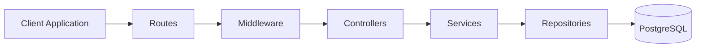
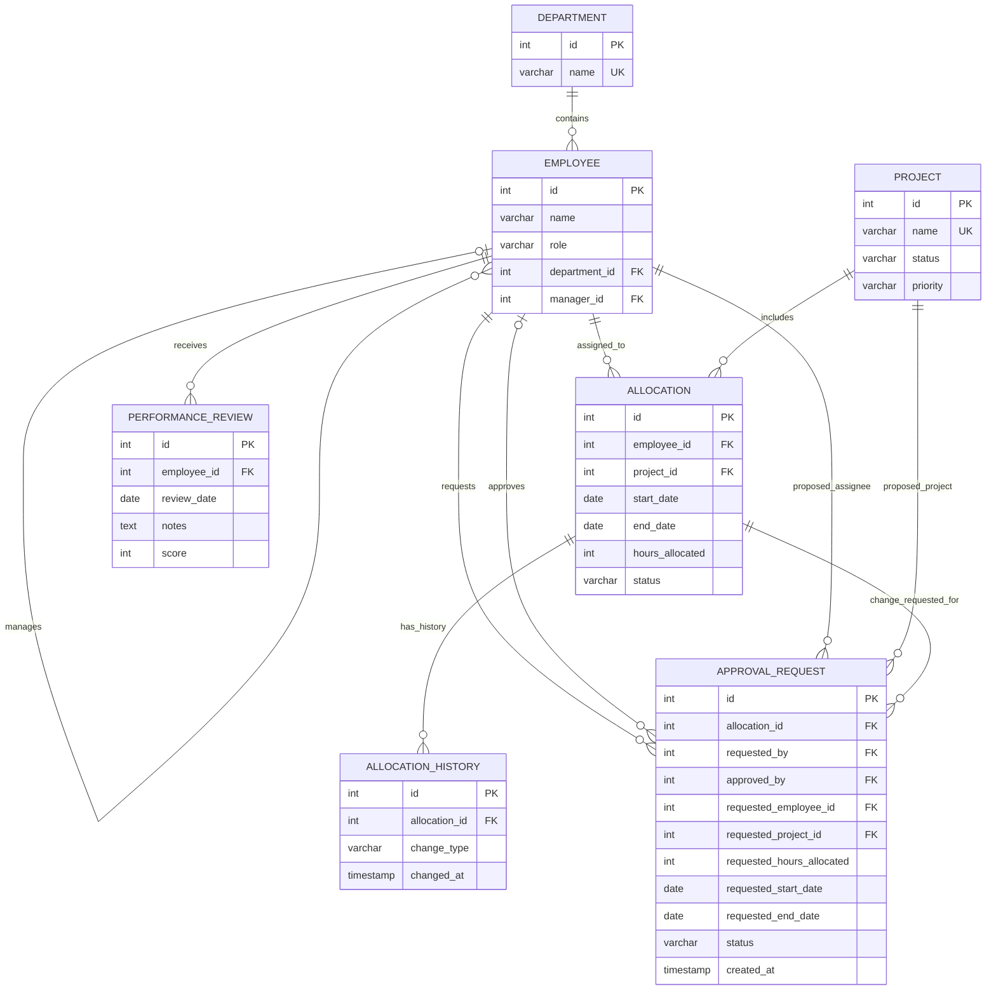

# WorkGrid

Tracks who is working on what, how loaded they are, and how allocation changes are managed.

## What This Is

WorkGrid is an employee workload and project allocation management system designed to organize employees, departments, projects, and work allocations.

It focuses on three key questions:

- Who is currently assigned to work?
- Who is available or overloaded?
- How should project allocations and reassignment requests be managed?

The system uses a relational database to store employee assignments, allocation details, performance reviews, and approval requests in a structured manner.

## Problem It Solves

Teams often manage assignments through spreadsheets or informal communication, making it difficult to track workload accurately or maintain consistent records.

WorkGrid provides a centralized database structure for employee allocation, project management, workload analysis, and allocation change requests. It is designed to improve visibility into team workload while maintaining relationships and data integrity through relational constraints.

## How It Works

- Employees are associated with departments and reporting managers.
- Projects are stored with their status and priority.
- Employees are assigned to projects through allocation records.
- Allocated working hours can be used to analyze employee workload.
- Allocation change requests store proposed changes separately from existing allocation records.
- Approval requests maintain their requester, approver, status, and proposed allocation details.
- Allocation history records are maintained separately from current allocation data.
- Performance reviews are stored independently and linked to employees.

## Features

### Phase 1 — Core Database Design

- Department and employee management structure
- Employee reporting hierarchy through manager relationships
- Project records with status and priority
- Employee-project allocation management
- Allocation duration, allocated hours, and status
- Relational constraints and referential integrity
- Workload-related SQL queries
- Employee, project, and allocation filtering

### Phase 2 — Extended Database Operations

- Performance review records and score tracking
- Allocation history records
- Structured allocation change requests
- Proposed employee, project, hours, and date changes
- Approval and rejection status management
- Transaction-oriented allocation reassignment operations
- Department-wise workload reports
- Employee workload and utilization analysis

## Tech Stack

| Layer | Technology |
|---|---|
| Database | PostgreSQL |
| Query Language | SQL |
| Database Design | ER Modeling, Relational Schema |
| Database Concepts | Normalization, Functional Dependencies, Constraints |
| Development Environment | Git, GitHub |

### Planned Application Stack

| Layer | Technology |
|---|---|
| Runtime | Node.js |
| Backend Framework | Express.js |
| ORM | Prisma |
| Authentication | JWT |
| Password Security | Password Hashing |
| Architecture | Routes → Controllers → Services → Repositories |

The application stack represents the planned backend architecture for WorkGrid. The current project deliverables focus on the database design, schema, and SQL operations.

## System Architecture



The proposed architecture separates responsibilities across different layers:

- **Routes:** Define application endpoints.
- **Middleware:** Handles request validation, authentication, and error processing.
- **Controllers:** Manage incoming requests and outgoing responses.
- **Services:** Contain business rules, workload logic, and approval workflows.
- **Repositories:** Handle database access.
- **Database:** Stores structured data and maintains relationships through constraints.

## Database Design

The database is organized around the allocation relationship between employees and projects.

An employee can work on multiple projects, and a project can involve multiple employees. The ALLOCATION relation connects employees and projects while storing assignment-specific information such as allocated hours, dates, and status.

Allocation change requests are maintained in APPROVAL_REQUEST, allowing proposed changes to be stored independently of the existing allocation.

### Entity Relationship Diagram



The self-referencing relationship in EMPLOYEE represents the reporting hierarchy, while ALLOCATION acts as the bridge between EMPLOYEE and PROJECT.

The database is designed with separate relations to reduce redundancy, maintain consistency, and support allocation-related queries and operations.

## Database Documentation

The `dbms/` directory contains the database design and SQL deliverables.

| File | Description |
|---|---|
| `01_normalization.md` | Normalization analysis covering 1NF, 2NF, 3NF, BCNF, and functional dependencies. |
| `02_er_diagram.md` | Entity relationship diagram, entities, attributes, cardinalities, and constraints. |
| `03_schema.sql` | SQL definitions for creating the WorkGrid database tables, constraints, and indexes. |
| `04_queries.sql` | SQL queries for allocation operations, reporting, workload analysis, approval requests, and analytics. |

## Core Database Operations

The SQL deliverables are designed to support the following operations:

- Retrieve employee allocation details.
- Analyze employee workload across projects.
- Identify available and overloaded employees based on allocation data.
- Filter employees and projects based on relevant attributes.
- Retrieve department-wise workload information.
- Review performance review records.
- Track allocation history.
- Create and manage allocation change requests.
- Process allocation-related changes through transaction-oriented SQL operations.
- Generate workload and project allocation reports.

## Project Structure

```text
WorkGrid/
├── backend/
│   ├── prisma/                     # Database schema & migrations
│   ├── src/
│   │   ├── config/                 # Prisma client connection
│   │   ├── controllers/            # Request handlers & domain business logic
│   │   ├── middlewares/            # Centralized error handler
│   │   └── routes/                 # Express API routes
│   └── server.js                   # Application server entrypoint
├── frontend/                       # Vanilla JS & Tailwind UI dashboard
├── dbms/
│   ├── 01_normalization.md
│   ├── 02_er_diagram.md
│   ├── 03_schema.sql
│   ├── 04_queries.sql
│   └── README.md
├── README.app-guide.md             # Complete architecture & API documentation
└── README.md
```

Detailed architecture specifications, database transactional semantics, and API endpoint usage can be found in [README.app-guide.md](./README.app-guide.md).

## Team

| Name | Enrolment Number |
|---|---|
| Uransh | 2501010690 |
| Puneet Kumar | 2501010361 |
| Varun Adwani | 2501010499 |
| Shlok Srivastava | 2501010434 |

---

WorkGrid — Structured workload allocation, relational integrity, and database-driven team management.
