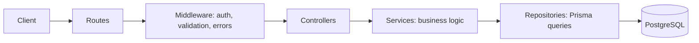
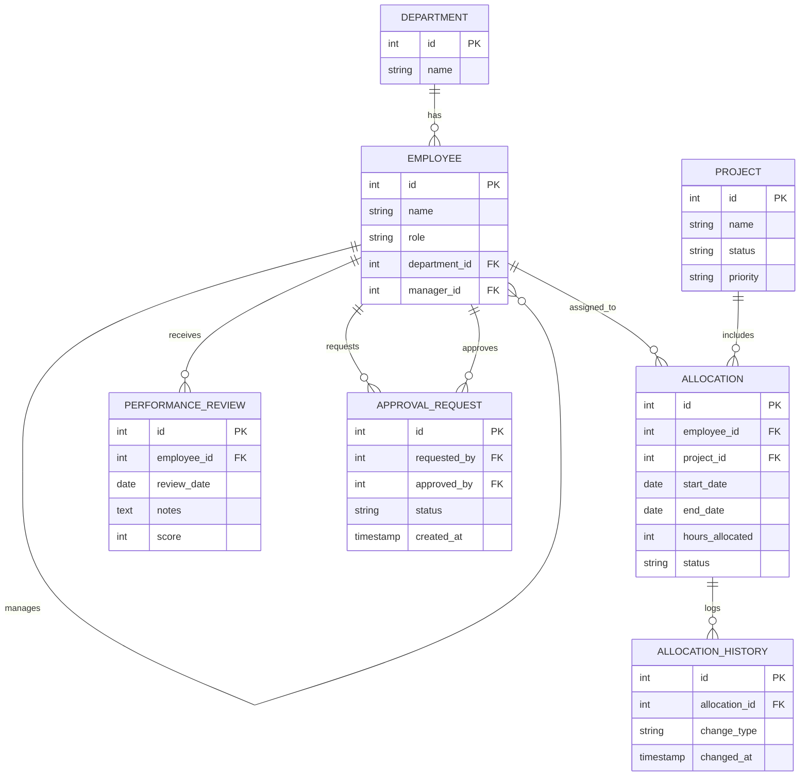
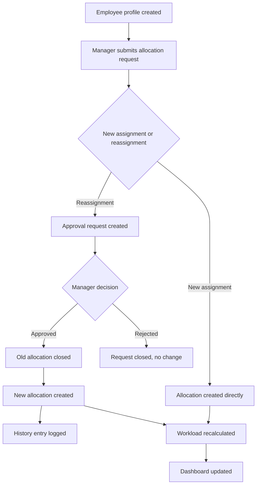

# WorkGrid

Tracks who is working on what, how loaded they are, and who approves the change.

## What This Is

WorkGrid is a backend system for managing employee workload and project allocation. It answers three questions a manager asks every day: who is free, who is overloaded, and who should be assigned to what. Every assignment, reassignment, and approval is recorded in a relational database, so the system also keeps a full history of how the team's workload has changed over time.

## Problem It Solves

Teams often assign work informally, through chat messages or spreadsheets that go out of date quickly. There is no single place to see current workload, no record of why someone was moved off a project, and no approval step before a reassignment happens. WorkGrid replaces that with one system: a live view of allocation, a required approval step for changes, and a permanent history log.

## How It Works

1. Employees are added to the system with a department and a reporting manager.
2. A manager assigns an employee to a project, creating an allocation.
3. The system tracks how many hours each employee is allocated across all active projects, and flags anyone overloaded or free.
4. Reassigning an employee closes the old allocation, opens a new one, and requires manager approval before it takes effect.
5. Every change is written to a history log, so past allocations are never lost, only closed.
6. Performance reviews are logged separately and linked to the employee record.

## Features

### Phase 1 (Mid-Semester)

- Employee profiles with department and manager
- Project records with status and priority
- Allocation form to assign an employee to a project
- Filters by team, role, project stage, and workload
- Dashboard showing active projects, free employees, and overloaded employees

### Phase 2 (End-Semester)

- Performance notes and monthly review records
- Allocation history and transfer history
- Department-wise reports
- Transaction-safe reassignment (old allocation closed and new one opened as a single operation)
- Approval flow for manager-initiated changes
- Utilization rate, overdue work, and task closure analytics

## Tech Stack

| Layer | Technology |
|---|---|
| Runtime | Node.js |
| Framework | Express.js |
| Database | PostgreSQL |
| ORM | Prisma |
| Auth | JWT, password hashing, role-based access |
| Architecture | Routes → Controllers → Services → Repositories |

## System Architecture



Each layer has one job. Routes define endpoints. Middleware checks the request before it reaches business logic. Controllers handle the request and response. Services hold the actual rules, such as workload limits and approval checks. Repositories are the only layer that talks to the database.

## Database Design

The schema is built around one core relationship: an employee is linked to a project through an allocation, and every change to that allocation is logged.



The self-referencing relationship on `EMPLOYEE` (manager to employee) allows the reporting chain to be queried directly, without a separate table.

## Core Workflow: Allocation Lifecycle



A new assignment does not require approval. A reassignment does, since it affects an already-active allocation. Both paths end at the same workload calculation, which keeps the dashboard numbers accurate.

## Project Structure

```
workgrid/
├── src/
│   ├── routes/
│   ├── controllers/
│   ├── services/
│   ├── repositories/
│   ├── middlewares/
│   └── prisma/
├── prisma/
│   ├── schema.prisma
│   └── migrations/
├── .env.example
└── package.json
```

## Team

| Name | Enrolment Number |
|---|---|
| Uransh | 2501010690 |
| Puneet | 2501010361 |
| Varun Adwani | 2501010499 |
| Shlok Srivastava | 2501010434 |
