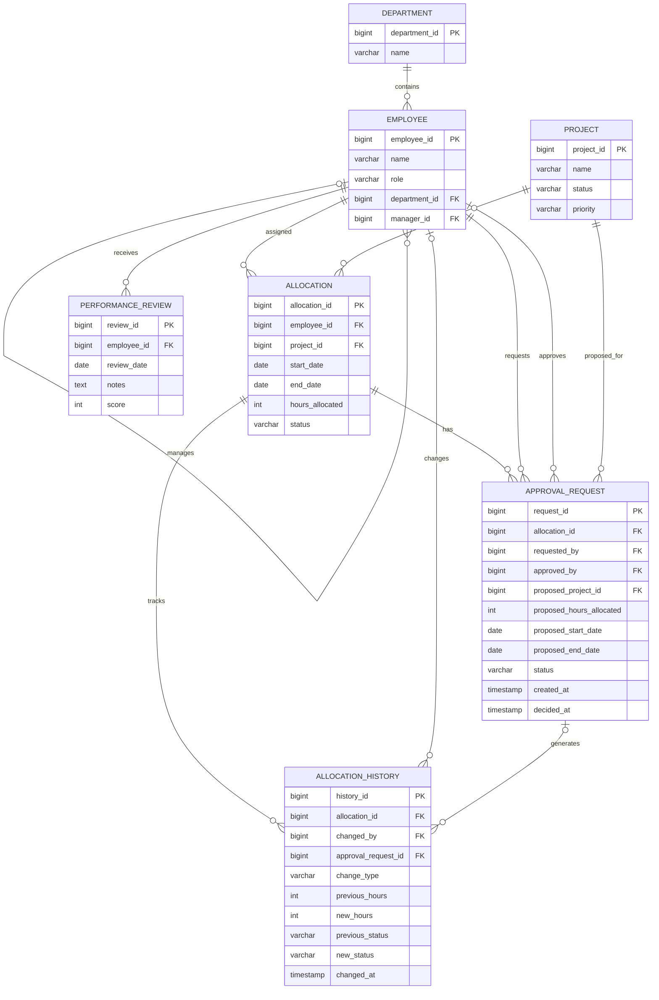

# WorkGrid — Entity Relationship Diagram (ERD)

**Project:** WorkGrid  
**Team:** T0085  
**Section:** B  
**Checkpoint:** CP2  
**Database:** PostgreSQL

## 1. Overview

WorkGrid is an employee workload and project allocation management system. It manages departments, employees, projects, project allocations, allocation history, performance reviews, and approval requests.

The database consists of seven entities connected through primary keys and foreign keys.

## 2. Entity Relationship Diagram

## 3. Entity Descriptions

| Entity | Description |
|---|---|
| DEPARTMENT | Stores department details within the organization. |
| EMPLOYEE | Stores employee details, department membership, and manager relationships. |
| PROJECT | Stores project details, status, and priority. |
| ALLOCATION | Connects employees with projects and tracks assigned hours and dates. |
| APPROVAL_REQUEST | Records requests for allocation changes and approval decisions. |
| ALLOCATION_HISTORY | Maintains records of allocation changes over time. |
| PERFORMANCE_REVIEW | Stores employee performance evaluations and review details. |

## 4. Relationships and Cardinality

| Relationship | Cardinality | Explanation |
|---|---|---|
| Department → Employee | 1:N | A department can have multiple employees. Each employee belongs to one department. |
| Employee → Employee | 1:N | An employee may manage multiple employees. An employee may have one manager. |
| Employee → Allocation | 1:N | An employee can have multiple allocations. |
| Project → Allocation | 1:N | A project can have multiple employee allocations. |
| Allocation → Approval Request | 1:N | An allocation can have multiple approval requests over time. |
| Employee → Approval Request (requester) | 1:N | An employee can create multiple approval requests. |
| Employee → Approval Request (approver) | 1:N | An employee can approve multiple requests. |
| Project → Approval Request | 1:N | A project can be the proposed destination of multiple allocation requests. |
| Allocation → Allocation History | 1:N | An allocation can have multiple historical change records. |
| Employee → Allocation History | 1:N | An employee can make multiple allocation changes. |
| Approval Request → Allocation History | 1:N | An approval request may result in historical allocation changes. |
| Employee → Performance Review | 1:N | An employee can receive multiple performance reviews. |

## 5. Design Considerations

- Each entity has a primary key to uniquely identify its records.
- Foreign keys establish relationships and enforce referential integrity.
- The EMPLOYEE entity has a self-referencing manager_id to represent the organizational hierarchy.
- ALLOCATION resolves the many-to-many relationship between EMPLOYEE and PROJECT.
- APPROVAL_REQUEST records proposed changes before approval.
- ALLOCATION_HISTORY maintains a historical record of allocation modifications.
- PERFORMANCE_REVIEW allows multiple evaluations for an employee over time.

## 6. Conclusion

The WorkGrid ER diagram represents the logical structure of the database and the relationships between its seven entities. It provides a foundation for implementing the database in PostgreSQL while supporting employee management, project assignments, approval workflows, allocation history, and performance tracking.
