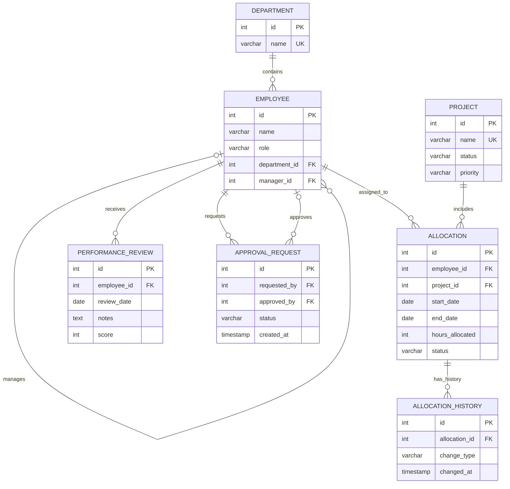

# WorkGrid - Entity Relationship Diagram (ERD)

**Project:** WorkGrid  
**Team:** T0085  
**Section:** B  
**Checkpoint:** CP2  
**Database:** PostgreSQL

## 1. Overview

WorkGrid is an employee workload and project allocation management system designed to manage departments, employees, projects, allocations, allocation history, performance reviews, and approval requests.

This ER diagram represents the relational database structure implemented in `03_schema.sql`. It illustrates the entities, attributes, primary keys, foreign keys, and relationships that form the WorkGrid database.

## 2. Entity Relationship Diagram

## 3. Entities and Their Purpose

| Entity | Description |
|---|---|
| DEPARTMENT | Stores department details and unique department names. |
| EMPLOYEE | Stores employee details, department membership, and manager hierarchy. |
| PROJECT | Stores project information, status, and priority. |
| ALLOCATION | Assigns employees to projects and records allocation duration, hours, and status. |
| ALLOCATION_HISTORY | Maintains a history of changes made to employee allocations. |
| PERFORMANCE_REVIEW | Stores performance reviews, scores, and review notes for employees. |
| APPROVAL_REQUEST | Records approval requests, requesters, approvers, and approval status. |

## 4. Relationships and Cardinality

| Relationship | Cardinality | Description |
|---|---|---|
| DEPARTMENT → EMPLOYEE | One-to-Many | A department may contain multiple employees. Each employee belongs to one department. |
| EMPLOYEE → EMPLOYEE | One-to-Many (Self-relationship) | An employee may manage multiple employees. An employee can have zero or one manager. |
| EMPLOYEE → ALLOCATION | One-to-Many | An employee may have multiple project allocations. Each allocation belongs to one employee. |
| PROJECT → ALLOCATION | One-to-Many | A project may have multiple allocations. Each allocation refers to one project. |
| ALLOCATION → ALLOCATION_HISTORY | One-to-Many | An allocation can have multiple historical change records. |
| EMPLOYEE → PERFORMANCE_REVIEW | One-to-Many | An employee may have multiple performance reviews. |
| EMPLOYEE → APPROVAL_REQUEST (Requester) | One-to-Many | An employee can create multiple approval requests. |
| EMPLOYEE → APPROVAL_REQUEST (Approver) | One-to-Many | An employee can approve multiple requests. An approval request may have no approver yet. |

## 5. Database Constraints

The database uses the following integrity constraints:

- **Primary Keys:** Every entity has a unique identifier (`id`).
- **Foreign Keys:** Maintain valid references between related entities.
- **Unique Constraints:** Department names and project names must be unique.
- **Employee Manager Constraint:** An employee cannot be their own manager.
- **Project Status Constraint:** Projects must have a valid status.
- **Project Priority Constraint:** Projects must have a valid priority.
- **Allocation Hours Constraint:** Allocated hours must be greater than zero.
- **Allocation Date Constraint:** The end date cannot precede the start date.
- **Allocation Status Constraint:** Allocations must have an allowed status.
- **Allocation History Constraint:** Change types must be valid.
- **Performance Score Constraint:** Review scores must be between 1 and 10.
- **Approval Status Constraint:** Approval requests must have an allowed status.
- **Approval Constraint:** An employee cannot approve their own request.

## 6. Design Considerations

- The EMPLOYEE table contains a self-referencing foreign key (`manager_id`) to represent the reporting hierarchy.
- ALLOCATION acts as the bridge between EMPLOYEE and PROJECT, allowing employees to work on multiple projects and projects to have multiple employees.
- ALLOCATION_HISTORY stores historical allocation changes separately from current allocation data.
- PERFORMANCE_REVIEW supports multiple review records for the same employee.
- APPROVAL_REQUEST tracks requests and approval decisions through requester and approver references.
- Foreign keys and constraints help maintain data consistency and integrity.

## 7. Conclusion

The WorkGrid ER diagram represents the database structure used for employee management, project management, workload allocation, allocation history, performance evaluation, and approval workflows.

The design uses primary keys, foreign keys, relational cardinalities, and integrity constraints to maintain a consistent database structure. It provides a foundation for database implementation and SQL operations in PostgreSQL.

The diagram is aligned with the current `03_schema.sql` implementation.
